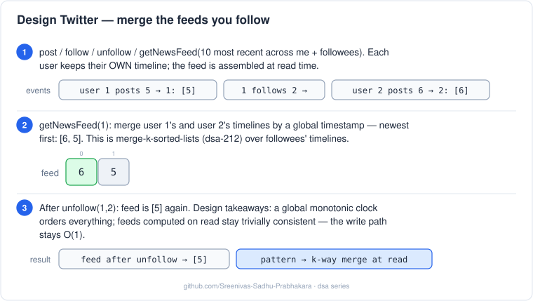

# Design Twitter

> NeetCode 150 · Heap — per-user tweet logs plus a follow set; the feed takes each source's last 10, then sorts — correct because nothing older can make the cut. Go, stdlib only, tested.

## Problem

A miniature Twitter: `PostTweet`, `Follow`/`Unfollow`, and `GetNewsFeed` returning the 10 most recent tweet ids across the user and everyone they follow, newest first.

## Approach

State is two maps: userId → tweet log (with a global logical clock stamping order — ids themselves carry no time meaning) and userId → followee set. The feed exploits a bound: the answer holds at most 10 tweets, so only each source's **last 10** can possibly appear — gather those, sort by timestamp descending, truncate. That's O(f·10 log(f·10)) per feed with trivial code; the canonical heap version k-way-merges the per-user logs (exactly dsa-073's cursor heap) and wins only when follow counts are large. Design problems grade API edges as much as algorithms: self-follows ignored, unfollow of a stranger a no-op, feeds strictly one-way — all pinned in tests.

**Complexity:** Post/Follow/Unfollow O(1); GetNewsFeed O(F log F) where F = 10·(followees+1).

## Visual walkthrough

Read the picture top to bottom — each numbered frame is one moment of the algorithm
running on this repo's test example.

## Run

    go test ./...   # verify
    go run .        # demo

---

Part of a 275-repo DSA series in Go — Striver's SDE Sheet (dsa-001–191) plus the NeetCode 150 / Blind 75 additions (dsa-192–275), stdlib only, every solution tested. Browse: [`dsa-*` repos](https://github.com/Sreenivas-Sadhu-Prabhakara?tab=repositories&q=dsa-&type=source).
